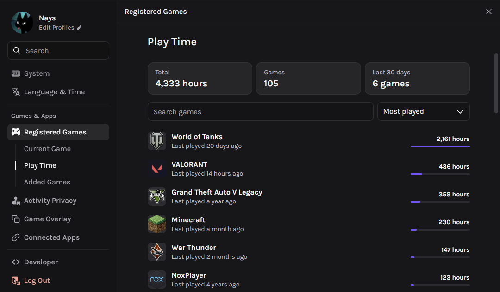
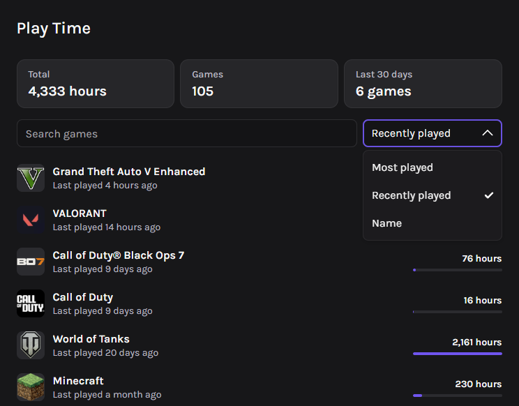
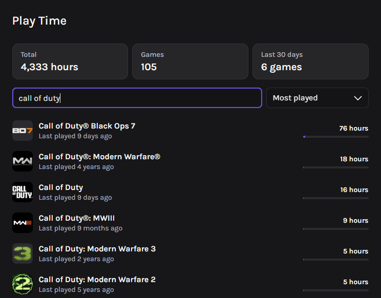

# playTime

shows how long you've played each game

## what it does

- total hours, number of games and how many of them you played in the last 30 days
- search and sort by most played, recently played or name

## install

if you made it here you probably already know how to install custom plugins, but if not just check [vencord's guide](https://docs.vencord.dev/installing/custom-plugins/)

## notes

the numbers come from discord itself so they only cover time discord was open and saw the game running
